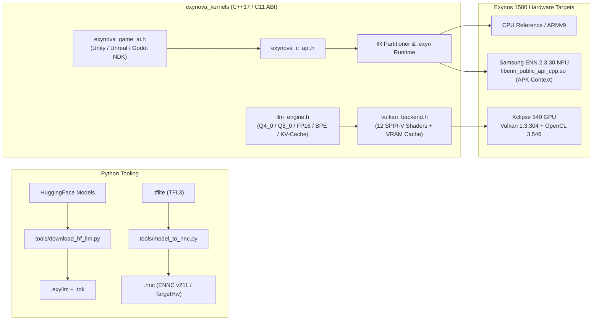

# ExyNova Kernels (`exynova-kernels`)

[](LICENSE)
[](CMakeLists.txt)
[](CMakeLists.txt)
[](#live-benchmarks-on-samsung-galaxy-a56-5g-sm-a566b)

**Open-source C++17 Vulkan RDNA compute kernels (`FP32`, `FP16`, `Q8_0`, `Q4_0` with 2D `M > 65535` vocab dispatch), Samsung ENN NPU runtime loader + Sister-`.nnc` Zoo, multi-quant LLM engine (`Qwen2.5-1.5B` + Word-BPE + `.exyllm v3`), 4-mode Flappy Bird AI example, and Android Game NDK SDK for Samsung Exynos 1580 (`S5E8855` / Galaxy A56 5G / Xclipse 540 GPU).**

> *Evidence-driven hardware engineering — zero simulated results, zero proprietary blobs.*

---

## Live Benchmarks on Samsung Galaxy A56 5G (`SM-A566B`)

### Flappy Bird AI & 128x Neon Swarm (`examples/flappy_bird_ai/`, `examples/neon_swarm_ai/`)


| Game / Mode | Hardware Path | Mean Frame Latency | Max AI Rate | NPU Stage | GPU Stage |
|---|---|---|---|---|---|
| **Flappy · `NPU`** | Samsung ENN `2.3.30` (`/dev/vertex10` spatial `.nnc`) | **`6.355 ms`** | `157.4 Hz` | `6.058 ms` | `0.000 ms` |
| **Flappy · `NPU + GPU`** | ENN `.nnc` features → Xclipse 540 64-agent Vulkan MLP | **`8.605 ms`** | `116.2 Hz` | `6.032 ms` | `0.028 ms` |
| **Flappy · `GPU`** | Xclipse 540 `Conv2D` sensor + 64-agent Vulkan MLP | **`0.795 ms`** | **`1258.1 Hz`** | `0.000 ms` | `0.039 ms` |
| **Flappy · `GPU + NPU`** | Xclipse 540 64-agent MLP → ENN `.nnc` hazard check | **`8.620 ms`** | `116.0 Hz` | `6.096 ms` | `0.029 ms` |
| **Neon Swarm · `GPU`** | Xclipse 540 `128`-agent Vulkan MLP (`128x8 → 16 → 2`) | **`0.902 ms`** | **`1108.9 Hz`** | `0.000 ms` | `0.029 ms` |
| **Neon Swarm · `GPU+NPU`** | Xclipse 540 `128`-agent MLP + ENN `/dev/vertex10` scan | **`8.580 ms`** | `116.6 Hz` | `6.183 ms` | `0.031 ms` |

### Quantization Speedup (`FP32` vs `FP16` vs `Q8_0` vs `Q4_0` on Xclipse 540)


### Real HuggingFace Chat LLMs (`Qwen2.5-1.5B`, `Qwen2.5-0.5B`, `TinyStories-15M`) + Sister/Rose `.nnc` NPU Proof


* **14/14 SPIR-V compute tests verified on `SM-A566B`:** 2D workgroup dispatch (`gl_WorkGroupID.y * 32768u + gl_WorkGroupID.x`) resolves the `M > 65535` row truncation on Xclipse 540 (`MatVec Q4_0 Vocab 70000x64` `max_abs_err = 9.537e-07`, `2537.19 us`); `960 MiB` VRAM cache prevents mid-dispatch eviction; `Q4_0` reaches **`5.29x` speedup** (`38.828 us`) and `6.40x` memory reduction vs CPU FP32.
* **Real HuggingFace LLMs on Xclipse 540 GPU (`.exyllm v3` + Word-Boundary BPE `tok_style=2`):**
  * **`Qwen2.5-1.5B-Instruct Q4_0`** (`1.48 GB`, `28L`, `qkv_bias=true`): **`1.56 tok/s`** inside the NPU+GPU Hybrid Vision-Chat APK (`1.29 tok/s` CLI).
  * **`Qwen2.5-0.5B-Instruct Q8_0`** (`789.89 MiB`, `24L`): **`2.60 tok/s`** in app (`1.91 tok/s` CLI).
  * **`TinyStories-15M Q4_0`** (`44.22 MiB`): **`18.38 tok/s`** | **`SmolLM2-135M Q4_0`** (`188.29 MiB`): **`3.43 tok/s`**.
* **Samsung Sister / Rose `.nnc` Compatibility (`6/6` live on `/dev/vertex10`, see [SISTER_MODELS_AND_NPU_PORTING.md](docs/SISTER_MODELS_AND_NPU_PORTING.md)):**
  * Galaxy A55 (`ex8845`), `Rose`, and native `Santa` `.nnc` models open and execute without cryptographic signature locks: `SRIB_HumanSeg` (`13.63 ms`), `SRIB_SID_V018` `[1,3,832,832]` (`61.84 ms`), `SRIBMidas_aiUPSCALER_2X` (`200.35 ms`), `SRIBMidas_aiDEBLUR_V140` (`145.41 ms`), `Santa aifrc` (`14.14 ms`), plus custom `valid_add_cpu_hw1.nnc` (`0.23 ms`, `ENN_RET_SUCCESS`).

---

## Architecture



---

## Quick Start

### 1. Host Build & Tests (Windows MSVC / Linux GCC / Clang)

```bash
cmake -S . -B build-host -DCMAKE_BUILD_TYPE=Release
cmake --build build-host --config Release -j 4
ctest --test-dir build-host -C Release --output-on-failure
```

### 2. Android ARM64 NDK Build

```bash
cmake -S . -B build-android \
  -DCMAKE_TOOLCHAIN_FILE=$ANDROID_NDK_HOME/build/cmake/android.toolchain.cmake \
  -DANDROID_ABI=arm64-v8a \
  -DANDROID_PLATFORM=android-34 \
  -DANDROID_STL=c++_static \
  -DCMAKE_BUILD_TYPE=Release
cmake --build build-android -j 4
```

This builds `libexynova_kernels.a`, `libexynova_kernels.so`, `game_npc_ai_demo`, `flappy_bird_ai_bench`, and `vulkan_probe`.

### 3. Download a HuggingFace LLM for Your App

```bash
python tools/download_hf_llm.py --preset tinystories-15m --quant q4_0 q8_0 --out-dir ./models
```

---

## Documentation & Clean-Room Policy

- **Plain-German Beginner Glossary & NPU Deep-Dive:** [GLOSSAR_EINFACH_ERKLAERT.md](docs/GLOSSAR_EINFACH_ERKLAERT.md) · [NPU_NNC_DEEP_DIVE.md](docs/NPU_NNC_DEEP_DIVE.md)
- **Game AI Examples:** [examples/flappy_bird_ai/](examples/flappy_bird_ai/) · [examples/neon_swarm_ai/](examples/neon_swarm_ai/)
- **Enabling Samsung ENN NPU inside APKs:**
  1. Declare `<uses-native-library android:name="libenn_public_api_cpp.so" android:required="false"/>` in `AndroidManifest.xml`.
  2. Never call `ABinderProcess_setThreadPoolMaxThreadCount()` inside an Android APK process.
  3. `.nnc` files have NO cryptographic signature check; `TargetHw=1` (`AddOptions`) runs cleanly on ENN (`0.36 ms`), while `TargetHw=4` (`ENN_NPU`) requires vendor `NCP v26` CMDQ bytecode, so route LLMs and arbitrary shaders to `VulkanComputeBackend` (`Q4_0` / `Q8_0` / `FP16`).
- **No proprietary blobs:** Zero vendor `.so`, `.nnc`, `.tflite`, model weights, or device serial numbers are committed.

---

`#Exynos1580 #GalaxyA56 #Xclipse540 #VulkanCompute #SamsungENN #NPU #OnDeviceAI #LocalLLM #Qwen25 #SmolLM2 #FlappyBirdAI #NeonSwarmAI #Quantization #Q4_0 #AndroidNDK #GameDev #RDNA`
