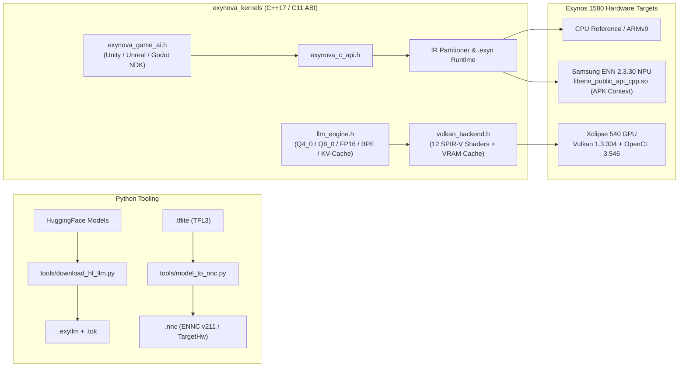

# ExyNova Kernels (`exynova-kernels`)

[](LICENSE)
[](CMakeLists.txt)
[](CMakeLists.txt)
[](#verified-galaxy-a56-5g-hardware-benchmarks)

**Open-source C++17 Vulkan RDNA compute kernels (`FP32`, `FP16`, `Q8_0`, `Q4_0`), Samsung ENN NPU runtime loader, multi-quant LLM engine (`BPE` + `KV-Cache`), 4-mode Flappy Bird AI example, and Android Game NDK SDK for Samsung Exynos 1580 (`S5E8855` / Galaxy A56 5G / Xclipse 540 GPU).**

> *Evidence-driven hardware engineering — zero simulated results, zero proprietary blobs.*

---

## Live Benchmarks on Samsung Galaxy A56 5G (`SM-A566B`)

### Flappy Bird AI & 128x Neon Swarm (`examples/flappy_bird_ai/`, `examples/neon_swarm_ai/`)


| Game / Mode | Hardware Path | Mean Frame Latency | Max AI Rate | NPU Stage | GPU Stage |
|---|---|---|---|---|---|
| **Flappy · `NPU`** | Samsung ENN `2.3.30` (`/dev/vertex10` spatial `.nnc`) | **`6.246 ms`** | `160.1 Hz` | `5.945 ms` | `0.000 ms` |
| **Flappy · `NPU + GPU`** | ENN `.nnc` features → Xclipse 540 64-agent Vulkan MLP | **`8.953 ms`** | `111.7 Hz` | `6.187 ms` | `0.024 ms` |
| **Flappy · `GPU`** | Xclipse 540 `Conv2D` sensor + 64-agent Vulkan MLP | **`2.477 ms`** | **`403.7 Hz`** | `0.000 ms` | `0.034 ms` |
| **Flappy · `GPU + NPU`** | Xclipse 540 64-agent MLP → ENN `.nnc` hazard check | **`9.239 ms`** | `108.2 Hz` | `6.360 ms` | `0.024 ms` |
| **Neon Swarm · `GPU`** | Xclipse 540 `128`-agent Vulkan MLP (`128x8 → 16 → 2`) | **`1.944 ms`** | **`514.4 Hz`** | `0.000 ms` | `0.026 ms` |
| **Neon Swarm · `GPU+NPU`** | Xclipse 540 `128`-agent MLP + ENN `/dev/vertex10` scan | **`9.239 ms`** | `108.2 Hz` | `6.192 ms` | `0.030 ms` |

### Quantization Speedup (`FP32` vs `FP16` vs `Q8_0` vs `Q4_0` on Xclipse 540)


### Real HuggingFace Chat LLMs (`Qwen2.5-0.5B`, `SmolLM2-135M`, `TinyStories-15M`) + Dynamic NPU Proof


* **13/13 SPIR-V compute kernels validated & verified on device** (`vec_add`, `vec_mul`, `relu`, `silu`, `softmax`, `matmul_f32`, `rmsnorm`, `rope_f32` interleaved & NeoX modes, `matvec_f16`, `matvec_q8_0`, `matvec_q4_0`, `conv2d_f32`), with persistent Vulkan slot buffers removing per-dispatch driver allocations (**`5.35x` speedup**, `6.4x` memory reduction in `Q4_0` vs CPU FP32).
* **Real HuggingFace LLMs on Xclipse 540 GPU (`Q4_0` + ChatML `.exyllm v3` + raw UTF-8 `ETOK`):**
  * **`TinyStories-15M Q4_0`** (`44.22 MiB`): **`18.38 tok/s`** (`2.58x` faster after slot-buffer reuse).
  * **`SmolLM2-135M-Instruct Q4_0`** (`188.29 MiB`, 30L): **`3.43 tok/s`**.
  * **`Qwen2.5-0.5B-Instruct Q4_0`** (`813.90 MiB`, 24L, `qkv_bias=true`): **`2.76 tok/s`** in German ChatML (`2.36–2.71 tok/s` CLI).
* **Dynamic NPU Proof & `ENNC v211` Deep-Dive (`docs/NPU_NNC_DEEP_DIVE.md`):**
  * Live dynamic verification on `/dev/vertex10`: `Scene A` (`7.14 ms`, `3f9058db92cf6a68`) != `Scene B` (`8.52 ms`, `b4b8477a5f793400`), `mean_abs_diff = 0.0020`.
  * Custom synthesized `valid_add_cpu_hw1.nnc` (`ENNC v211` with `AddOptions` + 4D tensors, `TargetHw=1`) opens and executes cleanly on Samsung ENN `2.3.30` (**`0.361 ms`, `ENN_RET_SUCCESS`**), while `TargetHw=4` (`ENN_NPU`) requires proprietary offline `NCP v26` CMDQ bytecode.

---

## Architecture



---

## Quick Start

### 1. Host Build & Tests (Windows MSVC / Linux GCC / Clang)

```bash
cmake -S . -B build-host -DCMAKE_BUILD_TYPE=Release
cmake --build build-host --config Release -j 4
ctest --test-dir build-host -C Release --output-on-failure
```

### 2. Android ARM64 NDK Build

```bash
cmake -S . -B build-android \
  -DCMAKE_TOOLCHAIN_FILE=$ANDROID_NDK_HOME/build/cmake/android.toolchain.cmake \
  -DANDROID_ABI=arm64-v8a \
  -DANDROID_PLATFORM=android-34 \
  -DANDROID_STL=c++_static \
  -DCMAKE_BUILD_TYPE=Release
cmake --build build-android -j 4
```

This builds `libexynova_kernels.a`, `libexynova_kernels.so`, `game_npc_ai_demo`, `flappy_bird_ai_bench`, and `vulkan_probe`.

### 3. Download a HuggingFace LLM for Your App

```bash
python tools/download_hf_llm.py --preset tinystories-15m --quant q4_0 q8_0 --out-dir ./models
```

---

## Documentation & Clean-Room Policy

- **Plain-German Beginner Glossary & NPU Deep-Dive:** [GLOSSAR_EINFACH_ERKLAERT.md](docs/GLOSSAR_EINFACH_ERKLAERT.md) · [NPU_NNC_DEEP_DIVE.md](docs/NPU_NNC_DEEP_DIVE.md)
- **Game AI Examples:** [examples/flappy_bird_ai/](examples/flappy_bird_ai/) · [examples/neon_swarm_ai/](examples/neon_swarm_ai/)
- **Enabling Samsung ENN NPU inside APKs:**
  1. Declare `<uses-native-library android:name="libenn_public_api_cpp.so" android:required="false"/>` in `AndroidManifest.xml`.
  2. Never call `ABinderProcess_setThreadPoolMaxThreadCount()` inside an Android APK process.
  3. `.nnc` files have NO cryptographic signature check; `TargetHw=1` (`AddOptions`) runs cleanly on ENN (`0.36 ms`), while `TargetHw=4` (`ENN_NPU`) requires vendor `NCP v26` CMDQ bytecode, so route LLMs and arbitrary shaders to `VulkanComputeBackend` (`Q4_0` / `Q8_0` / `FP16`).
- **No proprietary blobs:** Zero vendor `.so`, `.nnc`, `.tflite`, model weights, or device serial numbers are committed.

---

`#Exynos1580 #GalaxyA56 #Xclipse540 #VulkanCompute #SamsungENN #NPU #OnDeviceAI #LocalLLM #Qwen25 #SmolLM2 #FlappyBirdAI #NeonSwarmAI #Quantization #Q4_0 #AndroidNDK #GameDev #RDNA`
