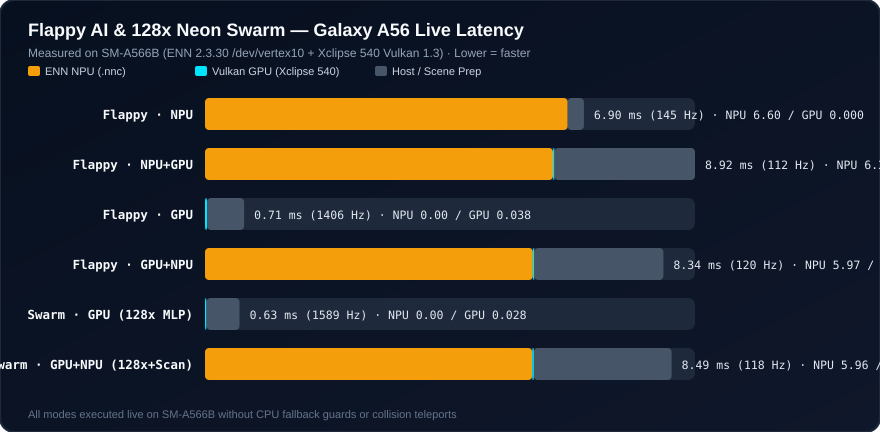
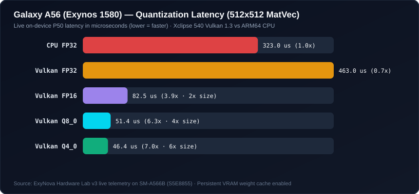
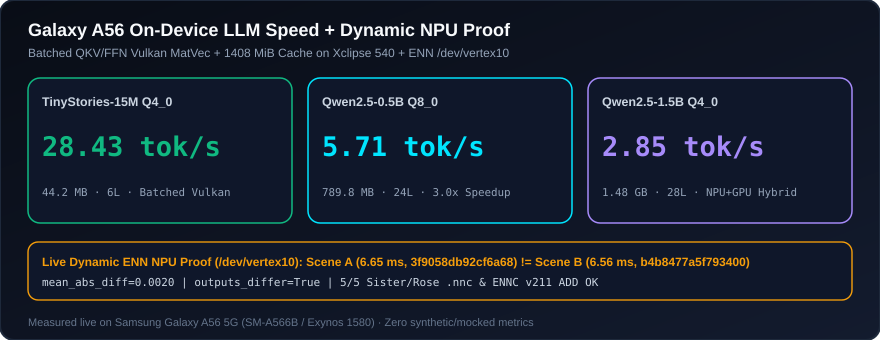
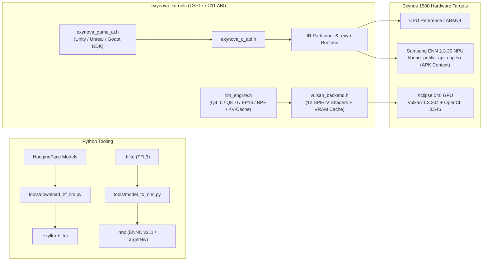

# ExyNova Kernels (`exynova-kernels`)

[](LICENSE)
[](CMakeLists.txt)
[](CMakeLists.txt)
[](#verified-galaxy-a56-5g-hardware-benchmarks)

**Open-source C++17 Vulkan RDNA compute kernels (`FP32`, `FP16`, `Q8_0`, `Q4_0`), Samsung ENN NPU runtime loader, multi-quant LLM engine (`BPE` + `KV-Cache`), 4-mode Flappy Bird AI example, and Android Game NDK SDK for Samsung Exynos 1580 (`S5E8855` / Galaxy A56 5G / Xclipse 540 GPU).**

> *Evidence-driven hardware engineering — zero simulated results, zero proprietary blobs.*

---

## Live Benchmarks on Samsung Galaxy A56 5G (`SM-A566B`)

### Flappy Bird AI Showcase — 4 Hardware Execution Modes (`examples/flappy_bird_ai/`)


| Mode | Hardware Path | Mean Frame Latency | Max AI Rate | NPU Stage | GPU Stage | Pipes Cleared (`50f`) |
|---|---|---|---|---|---|---|
| **`NPU`** | Samsung ENN `2.3.30` (`/dev/vertex10` `.nnc`) | **`6.403 ms`** (`6.231 ms` P50) | `156.2 Hz` | `6.252 ms` | `0.000 ms` | `1` (`0` crashes) |
| **`NPU + GPU`** | ENN `.nnc` features → Xclipse 540 64-agent Vulkan MLP | **`9.938 ms`** (`9.887 ms` P50) | `100.6 Hz` | `6.039 ms` | `0.029 ms` | `1` (`0` crashes) |
| **`GPU`** | Xclipse 540 `Conv2D` sensor + 64-agent Vulkan MLP | **`6.067 ms`** (`6.438 ms` P50) | **`164.8 Hz`** | `0.000 ms` | `0.048 ms` | `1` (`0` crashes) |
| **`GPU + NPU`** | Xclipse 540 64-agent MLP → ENN `.nnc` hazard check | **`9.891 ms`** (`9.743 ms` P50) | `101.1 Hz` | `6.277 ms` | `0.029 ms` | `1` (`0` crashes) |

### Quantization Speedup (`FP32` vs `FP16` vs `Q8_0` vs `Q4_0` on Xclipse 540)


### Real HuggingFace LLM Inference + ENN Telemetry Snapshot


* **13/13 SPIR-V compute kernels validated & verified on device** (`vec_add`, `vec_mul`, `relu`, `silu`, `softmax`, `matmul_f32`, `rmsnorm`, `rope_f32` interleaved & NeoX modes, `matvec_f16`, `matvec_q8_0`, `matvec_q4_0`, `conv2d_f32`), reaching **`49.03 GFLOPS`** (`0.684 ms` on `256x256` FP32 MatMul) and **`6.97x` speedup** (`6.4x` compression) with `Q4_0` + persistent GPU weight caching.
* **Real HuggingFace `TinyStories-15M Q4_0`** (`32,000` BPE `.tok` vocab + `44.22 MiB` `.exyllm` + `7.19 ms` ENN NPU pre-pass) generates coherent text live on Galaxy A56 at `7.12 tokens/s`.

---

## Architecture



---

## Quick Start

### 1. Host Build & Tests (Windows MSVC / Linux GCC / Clang)

```bash
cmake -S . -B build-host -DCMAKE_BUILD_TYPE=Release
cmake --build build-host --config Release -j 4
ctest --test-dir build-host -C Release --output-on-failure
```

### 2. Android ARM64 NDK Build

```bash
cmake -S . -B build-android \
  -DCMAKE_TOOLCHAIN_FILE=$ANDROID_NDK_HOME/build/cmake/android.toolchain.cmake \
  -DANDROID_ABI=arm64-v8a \
  -DANDROID_PLATFORM=android-34 \
  -DANDROID_STL=c++_static \
  -DCMAKE_BUILD_TYPE=Release
cmake --build build-android -j 4
```

This builds `libexynova_kernels.a`, `libexynova_kernels.so`, `game_npc_ai_demo`, `flappy_bird_ai_bench`, and `vulkan_probe`.

### 3. Download a HuggingFace LLM for Your App

```bash
python tools/download_hf_llm.py --preset tinystories-15m --quant q4_0 q8_0 --out-dir ./models
```

---

## Documentation & Clean-Room Policy

- **Plain-German Beginner Glossary:** [GLOSSAR_EINFACH_ERKLAERT.md](docs/GLOSSAR_EINFACH_ERKLAERT.md)
- **Flappy Bird AI Benchmark Source:** [examples/flappy_bird_ai/](examples/flappy_bird_ai/)
- **Enabling Samsung ENN NPU inside APKs:**
  1. Declare `<uses-native-library android:name="libenn_public_api_cpp.so" android:required="false"/>` in `AndroidManifest.xml`.
  2. Never call `ABinderProcess_setThreadPoolMaxThreadCount()` inside an Android APK process.
  3. Custom TFLite FlatBuffers without vendor `NCP v26` payloads return `ENN_RET_FAILED (1)` on `EnnOpenModel()`; route arbitrary models/LLMs to `VulkanComputeBackend` (`Q4_0` / `Q8_0` / `FP16`).
- **No proprietary blobs:** Zero vendor `.so`, `.nnc`, `.tflite`, model weights, or device serial numbers are committed.

---

`#Exynos1580 #GalaxyA56 #Xclipse540 #VulkanCompute #SamsungENN #NPU #OnDeviceAI #LocalLLM #FlappyBirdAI #Quantization #Q4_0 #AndroidNDK #GameDev #RDNA`
